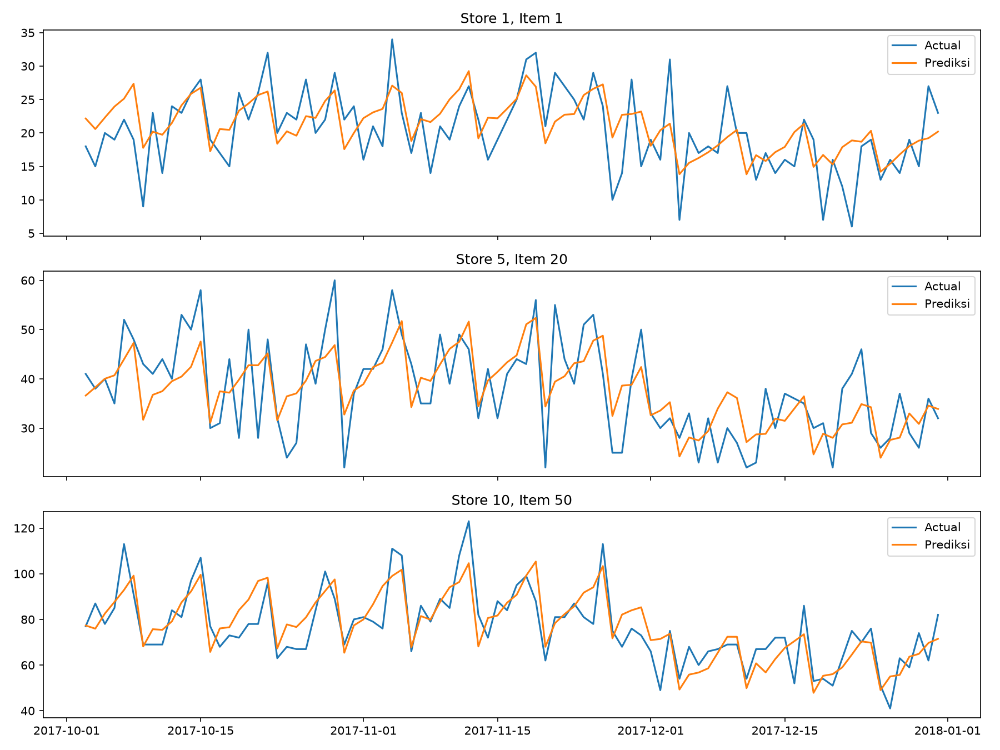

# Store Sales Demand Forecasting

Peramalan penjualan harian 50 item di 10 toko untuk 90 hari ke depan.

## Dataset
Kaggle: Store Item Demand Forecasting Challenge (913.000 baris, 2013-2017).
Unduh dengan `kaggle competitions download -c demand-forecasting-kernels-only -p data/raw`.

## Alur kerja
1. `01_data_wrangling`: validasi tipe data dan kelengkapan tanggal
2. `02_eda`: trend, seasonality, perbandingan toko
3. `03_feature_baseline`: calendar features, lag features, baseline
4. `04_modeling`: Linear Regression, Ridge, XGBoost, GridSearchCV

## Hasil
| Model | SMAPE | MAE |
|-------------------|-----------|----------|
| XGBoost (tuned)   | 12.457008 | 5.919904 |
| Ridge (tuned)     | 16.166070 | 7.857757 |
| Linear Regression | 16.167258 | 7.857922 |
| DOW mean          | 17.296059 | 8.758047 |
| Seasonal naive    | 17.865486 | 8.350489 |

## Cara menjalankan
pip install -r requrements.txt
